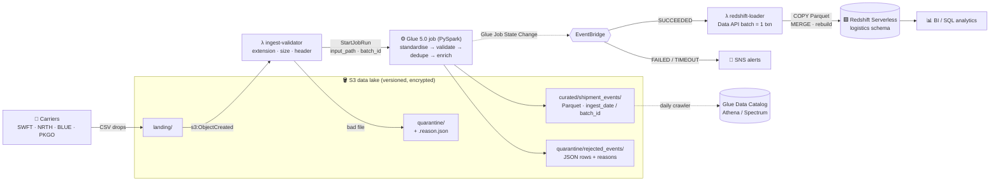
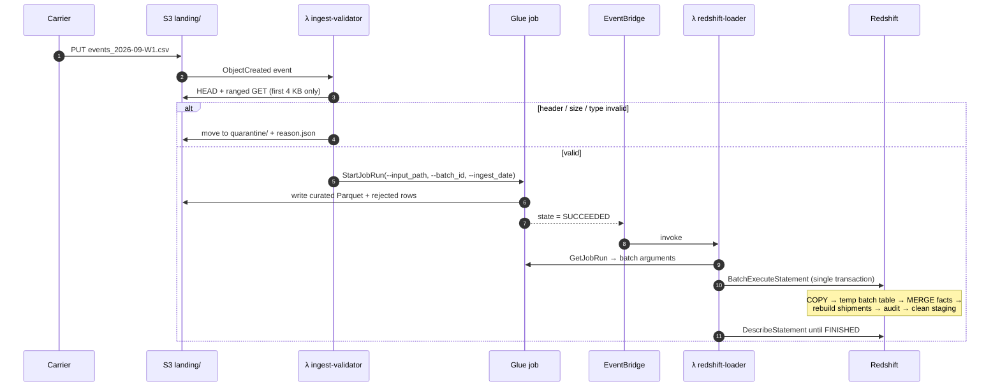
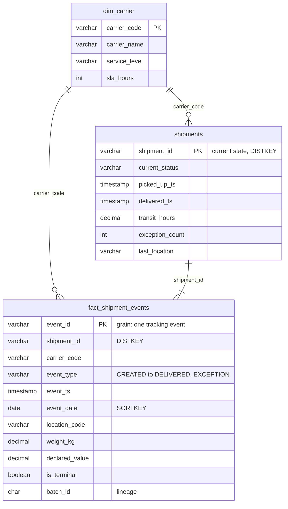

<div align="center">

# Serverless Shipment Data Pipeline on AWS

### S3 · Lambda · Glue (PySpark) · Redshift Serverless · EventBridge · Terraform

Event-driven ingestion of carrier tracking files into an analytics warehouse. Nothing runs unless there is data, and the whole platform is defined in Terraform.


**Built by [Aitomation](https://aitomation.com)** · Data Engineering · Cloud · Automation

</div>

---

## Table of contents

- [The business problem](#the-business-problem)
- [Architecture](#architecture)
- [How data flows](#how-data-flows)
- [Components](#components)
- [Redshift data model](#redshift-data-model)
- [Reliability & data quality](#reliability--data-quality)
- [Quick start](#quick-start)
- [Sample output](#sample-output)
- [Project structure](#project-structure)
- [Testing & CI/CD](#testing--cicd)
- [Cost & security](#cost--security)
- [About Aitomation](#about-aitomation)

---

## The business problem

A logistics company works with four parcel carriers. Each carrier drops tracking-event files (CSV) several times a day. The files are inconsistent: event names differ per carrier (`DLVD`, `Delivered`, `DELIVERED`), timestamps come in three formats, weights arrive as `"12.5kg"`, declared values as `"$1,250.00"`, events are re-sent, and occasionally a file has the wrong layout entirely.

The operations team needed **near-real-time answers** to three questions:

1. Which carrier actually meets its delivery SLA?
2. Which shipments are stuck right now?
3. How do pickup, delivery and exception volumes trend day by day?

The platform also had to be **cheap when idle**, **hands-off to operate**, and **reproducible** across dev and prod.

## Architecture



## How data flows



## Components

| Component | Responsibility | Code |
|---|---|---|
| **λ ingest-validator** | Cheap pre-flight checks without downloading the whole file: extension, size limits, required CSV columns. Bad files move to `quarantine/` with a JSON explanation. Good files start Glue with a fresh `batch_id` | [`src/lambdas/ingest_validator/handler.py`](src/lambdas/ingest_validator/handler.py) |
| **Glue job (PySpark)** | Explicit all-string schema, then: trim/upper-case codes, map carrier aliases to a canonical event type, parse 3 timestamp formats, clean `"12.5kg"` / `"$1,250"`, run 7 validation rules (all failures listed per row), dedupe re-sent events, add lineage columns, write Parquet | [`src/glue_jobs/shipment_events_etl.py`](src/glue_jobs/shipment_events_etl.py) |
| **EventBridge** | Glue `SUCCEEDED` triggers the loader. `FAILED` / `TIMEOUT` sends an SNS alert | [`infra/terraform/eventbridge.tf`](infra/terraform/eventbridge.tf) |
| **λ redshift-loader** | Renders the load SQL with injection-safe values and submits it as **one Data API batch**, which is atomic. Waits and raises on failure, so EventBridge retries | [`src/lambdas/redshift_loader/handler.py`](src/lambdas/redshift_loader/handler.py) |
| **Load SQL** | `COPY … FORMAT AS PARQUET` → temp batch table → `MERGE` into the fact table → rebuild the current-state snapshot for affected shipments → audit row | [`load_batch.sql`](src/lambdas/redshift_loader/sql/load_batch.sql) |
| **Terraform** | S3 (versioning, SSE, public-access block, lifecycle), Lambdas, Glue job and crawler, EventBridge, SNS, Redshift Serverless, least-privilege IAM | [`infra/terraform/`](infra/terraform) |

## Redshift data model



`fact_shipment_events` and `shipments` share **`DISTKEY(shipment_id)`**, so the per-shipment rebuild joins stay on one node. Facts use a **compound sort key on `(event_date, carrier_code)`** for the time-sliced dashboard queries. Ready-made analytics: [`carrier_sla_performance.sql`](sql/redshift/analytics/carrier_sla_performance.sql), [`stuck_shipments.sql`](sql/redshift/analytics/stuck_shipments.sql), [`daily_volume.sql`](sql/redshift/analytics/daily_volume.sql).

## Reliability & data quality

| Concern | How it's handled |
|---|---|
| Malformed files | Rejected **before** Glue spends compute on them, then quarantined with a reason |
| Bad rows | Flagged with *every* rule they break (`missing_event_id, invalid_weight`) and written to `quarantine/rejected_events/` |
| Duplicate / re-sent events | Window dedupe in Glue, plus `MERGE` on `event_id` in Redshift. Replaying a file is harmless |
| Partial loads | The Data API batch is a single transaction: all statements commit together or none do |
| Concurrent batches | Each load works on a `batch_id`-scoped temp table, so parallel Glue runs (up to 5) never interfere |
| SQL injection | Batch id and date are validated against strict regexes before rendering |
| Failures | Glue retries once. EventBridge retries the loader twice. Lambda dead-letter queues and Glue failures publish to SNS |
| Traceability | Every row carries `batch_id`, and Glue writes metrics to CloudWatch. `logistics.load_audit` records each load |

## Quick start

### Run everything locally (no AWS account)

```bash
pip install -e ".[dev]"
python scripts/generate_sample_data.py        # 16 carrier files → data/landing/
pytest                                        # Lambda tests against moto (mocked S3, Glue)
make test-spark                               # Glue PySpark tests in a Spark container
make glue-local                               # run the real Glue job on the sample data → ./output
```

### Deploy to AWS

```bash
cp infra/terraform/terraform.tfvars.example infra/terraform/terraform.tfvars
make deploy                                   # terraform init + apply

# one-time warehouse setup (Redshift Query Editor v2):
#   sql/redshift/000_dim_carrier.sql, 001_schema.sql, 002_grants.sql

make upload                                   # sync sample files to s3://<bucket>/landing/ → pipeline runs
```

Then query `logistics.shipments` or run the files in `sql/redshift/analytics/`. Tear down with `make destroy`.

## Sample output

`make glue-local` runs the real Glue job on the bundled carrier files (3,643 events, 4 carriers) and prints the run metrics that also go to CloudWatch in AWS:

```json
{
  "batch_id": "...",
  "rows_read": 3643,
  "rows_curated": "...",
  "rows_rejected": "...",
  "rows_deduplicated": "...",
  "reject_reasons": { "missing_event_id": "...", "invalid_event_ts": "...", "invalid_weight": "...", "unknown_event_type": "..." }
}
```

The ingest validator, given [`data/samples/malformed_header.csv`](data/samples/malformed_header.csv):

```json
{
  "key": "landing/malformed_header.csv",
  "status": "quarantined",
  "problems": ["missing_columns:event_id,shipment_id,carrier_code,event_type,event_ts,location_code,customer_id,weight_kg,declared_value"],
  "target": "quarantine/malformed_header.csv"
}
```

## Project structure

```text
aws-s3-glue-lambda-redshift-pipeline/
├── infra/terraform/              # S3, Lambda, Glue, EventBridge, SNS, Redshift Serverless, IAM
├── src/
│   ├── lambdas/
│   │   ├── ingest_validator/     # S3 trigger → validate → start Glue
│   │   └── redshift_loader/      # Glue SUCCEEDED → COPY + MERGE via Data API
│   │       └── sql/load_batch.sql
│   └── glue_jobs/
│       └── shipment_events_etl.py
├── sql/redshift/                 # schema, grants, analytics queries
├── scripts/generate_sample_data.py
├── data/landing/                 # synthetic carrier files (carrier=XXXX/…)
├── tests/                        # moto Lambda tests + PySpark Glue tests
├── .github/workflows/ci.yml      # lint · unit · spark · terraform validate
└── Makefile
```

## Testing & CI/CD

| Suite | What it proves | Runs with |
|---|---|---|
| `test_ingest_validator.py` | Valid files start Glue with correct arguments. URL-encoded keys work. Wrong extension, empty, oversized and wrong-header files are *moved* to quarantine with a reason | moto (S3, Glue) |
| `test_redshift_loader.py` | SQL renders correctly and comments are stripped. Unsafe batch ids are refused. One batch is submitted with the right S3 path. Waits for completion. Failed loads raise so they get retried | moto + fake Data API |
| `test_glue_transforms.py` | Standardisation, alias mapping, multi-format timestamps, multi-rule validation, dedupe, curated schema, and an end-to-end `run()` writing real Parquet | PySpark 3.5 |

GitHub Actions runs **lint + Lambda tests**, **PySpark tests** (Java 17, Python 3.11 to match Glue 5.0), and **`terraform fmt` + `validate`** on every push.

## Cost & security

- **Pay-per-use**: Lambda and Glue only run when files arrive. Redshift Serverless bills per RPU-second and scales to zero when idle.
- **Storage tiers**: landing files expire after 30 days, and curated data moves to S3 Standard-IA after 90.
- **Least privilege**: each Lambda can touch only its own prefixes and API actions. Redshift's COPY role can read `curated/` only.
- **No secrets in code**: the Redshift admin password is generated and stored by Secrets Manager (`manage_admin_password`), and the loader uses IAM auth through the Data API.
- **Encrypted & private**: SSE on S3, all public access blocked, Redshift workgroup not publicly accessible.

---

## About Aitomation

**Aitomation** builds data platforms and automation for growing businesses: ETL/ELT pipelines, cloud data warehouses, orchestration, real-time streaming and analytics.

| # | Project | Stack |
|---|---|---|
| 1 | End-to-End ETL Data Pipeline | Python · SQL · PostgreSQL |
| 2 | **Cloud Data Engineering on AWS** *(this repo)* | S3 · Glue · Lambda · Redshift |
| 3 | Cloud Data Engineering on Azure | Data Factory · Synapse Analytics |
| 4 | Big Data Processing Pipeline | Databricks · PySpark |
| 5 | Modern Data Warehouse & ELT | Snowflake · dbt |
| 6 | Automated Pipeline Orchestration | Apache Airflow |
| 7 | Real-Time Big Data Pipeline | Apache Kafka · Spark Streaming |

**Need something similar?** [Get in touch at aitomation.com](https://aitomation.com).

<div align="center"><sub>Released under the <a href="LICENSE">MIT License</a> · © 2026 Aitomation</sub></div>
